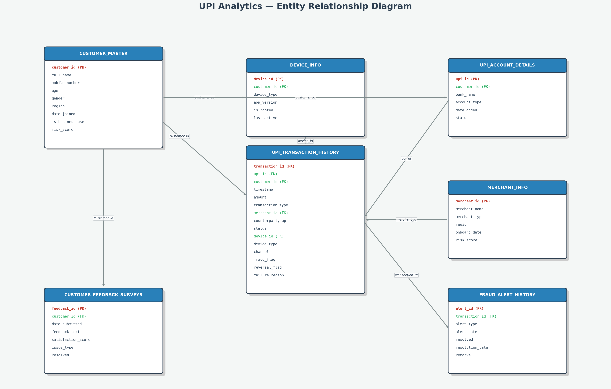

<p align="center">
  
</p>

<h1 align="center">💳 UPI Transaction Data Analysis — Capstone Project</h1>

<p align="center">
  
  
  
  
  
  
</p>

<p align="center">
  <em>An end-to-end analytics pipeline — from raw CSVs to a MySQL database, Python-driven EDA with statistical testing, and an interactive Power BI dashboard — uncovering fraud patterns, regional trends, and customer behaviour in India's UPI ecosystem.</em>
</p>

---

## 📌 Overview

This capstone project performs a **full-stack data analysis** of Unified Payments Interface (UPI) transactions across India. The pipeline covers:

1. **Data Ingestion** — 7 raw CSV datasets covering customers, merchants, devices, transactions, fraud alerts, and feedback  
2. **Database Design** — Relational MySQL schema with foreign-key constraints and data integrity checks  
3. **Data Cleaning & Validation** — Quality profiling, conditional formatting, and a validation log in Excel  
4. **Exploratory Data Analysis** — Jupyter Notebook with Pandas for deep-dive exploration  
5. **Statistical Hypothesis Testing** — T-test, ANOVA, and Chi-square tests to validate fraud hypotheses  
6. **Dashboard & Reporting** — Interactive Power BI dashboard and executive presentation  

---

## ✨ Key Highlights

- 🔍 **Fraud Detection Insights** — Identified that older Android devices and rooted phones exhibit significantly higher fraud rates  
- 🌍 **Regional Fraud Patterns** — ANOVA revealed statistically significant differences in fraud distribution across Indian regions  
- 📱 **Channel-Based Analysis** — Chi-square test confirmed that payment channel (QR scan, NFC, in-app) is associated with fraud likelihood  
- 📊 **End-to-End Pipeline** — Raw data → SQL schema → Python EDA → Power BI dashboard → Presentation  

---

## 🗄️ Database Schema

The MySQL database `upi_analytics` consists of **7 normalized tables** linked through foreign keys:

| # | Table | Description | Primary Key |
|---|-------|-------------|-------------|
| 1 | `customer_master` | Customer demographics, risk scores, business flags | `customer_id` |
| 2 | `merchant_info` | Merchant details, type, region, risk score | `merchant_id` |
| 3 | `upi_account_details` | UPI IDs linked to customers and banks | `upi_id` |
| 4 | `device_info` | Device metadata, app version, rooted status | `device_id` |
| 5 | `upi_transaction_history` | Core transaction ledger with fraud/reversal flags | `transaction_id` |
| 6 | `fraud_alert_history` | Fraud alerts raised against transactions | `alert_id` |
| 7 | `customer_feedback_surveys` | Customer satisfaction scores and issue tracking | `feedback_id` |

### 🔗 ER Diagram

<p align="center">
  
</p>

---

## 📈 Statistical Tests & Findings

| Test | Hypothesis | Variables | Result |
|------|-----------|-----------|--------|
| **Independent T-Test** | Android users experience more fraud than iOS users | `device_type` vs `fraud_flag` | ✅ Significant — older Android devices show higher fraud rates |
| **One-Way ANOVA** | Fraud rates differ across regions | `region` vs `fraud_flag` | ✅ Significant — regional fraud patterns confirmed |
| **Chi-Square Test** | Payment channel is associated with fraud | `channel` vs `fraud_flag` | ✅ Significant — channel type impacts fraud likelihood |

---

## 📁 Project Structure

```
UPI-Analytics-Capstone-Project/
│
├── data/
│   ├── raw/                                    # Original CSV datasets
│   │   ├── customer_master.csv
│   │   ├── merchant_info.csv
│   │   ├── upi_account_details.csv
│   │   ├── device_info.csv
│   │   ├── upi_transaction_history.csv
│   │   ├── fraud_alert_history.csv
│   │   └── customer_feedback_surveys.csv
│   │
│   └── cleaned/                                # Processed & validated data
│       ├── Cleaned_Consolidated_UPI_Data.xlsx
│       ├── Data_Quality_Conditional_Formatting.xlsx
│       └── Data_Validation_and_Quality_Log.xlsx
│
├── notebooks/
│   └── upi_analysis.ipynb                      # EDA & statistical testing
│
├── sql/
│   ├── upi_db_schema.sql                       # MySQL DDL scripts
│   └── Database_DDL_Scripts.txt                 # Schema documentation
│
├── dashboard/
│   └── UPI_ANALYTICS_POWERBI.pbix              # Power BI dashboard
│
├── docs/
│   ├── ER_Diagram_Detailed.png                 # Entity-Relationship diagram
│   ├── UPI_Analytics_Presentation.pptx         # Executive presentation
│   └── Upianalytics_Summary.xlsx               # Summary workbook
│
├── .gitignore
└── README.md
```

---

## 🛠️ Tech Stack

| Layer | Technology |
|-------|-----------|
| **Database** | MySQL |
| **Data Processing** | Python, Pandas, NumPy |
| **Statistical Analysis** | SciPy (T-test, ANOVA, Chi-square) |
| **EDA & Visualization** | Jupyter Notebook, Matplotlib, Seaborn |
| **Dashboard** | Microsoft Power BI |
| **Data Validation** | Microsoft Excel |

---

## 🚀 How to Use

1. **Clone the repository**
   ```bash
   git clone https://github.com/s0-umya/UPI-Analytics-Capstone-Project.git
   cd UPI-Analytics-Capstone-Project
   ```

2. **Set up the database**
   ```bash
   mysql -u root -p < sql/upi_db_schema.sql
   ```

3. **Load raw data** — Import CSVs from `data/raw/` into the MySQL tables

4. **Run the analysis notebook**
   ```bash
   pip install pandas numpy scipy matplotlib seaborn jupyter
   jupyter notebook notebooks/upi_analysis.ipynb
   ```

5. **Explore the dashboard** — Open `dashboard/UPI_ANALYTICS_POWERBI.pbix` in Power BI Desktop

---

## 👨‍💻 Author

**Soumya Das**  
GitHub: [@s0-umya](https://github.com/s0-umya)

---

<p align="center">
  
  
</p>
